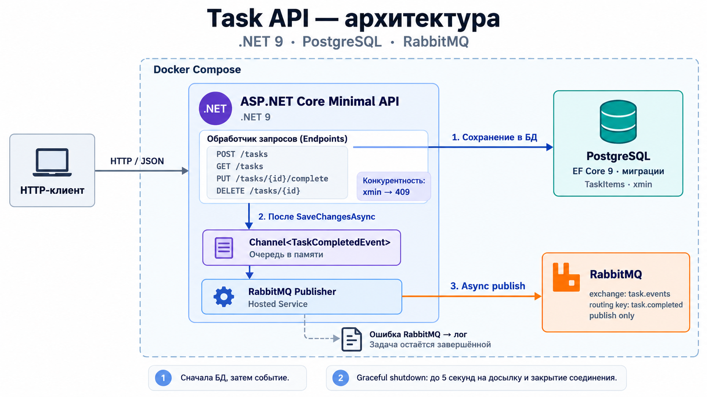

# Task API

Тестовое задание: .NET 9, ASP.NET Core Minimal API, PostgreSQL + EF Core, RabbitMQ (только публикация).



## Запуск через Docker Compose

Нужен работающий Docker Desktop с Linux containers.

```powershell
docker compose up --build -d
docker compose logs -f api
```

- API: http://localhost:8080/tasks
- Swagger UI: http://localhost:8080/swagger — описание маршрутов, модели и отправка запросов через Try it out.
- OpenAPI JSON: http://localhost:8080/swagger/v1/swagger.json
- RabbitMQ Management: http://localhost:15672 — логин `taskapi`, пароль `taskapi`.
- PostgreSQL: `localhost:5432`, база `task_api`, пользователь/пароль `taskapi`.

Это локальные демонстрационные credentials. При необходимости скопируйте `.env.example` в `.env` и измените порты/пароли. Для локального запуска API вне Docker параметры подключения задаются отдельно через конфигурацию .NET.

Если порт 5432 занят локальным PostgreSQL, задайте в `.env` `POSTGRES_PORT=15432`. Внутри Compose база продолжает работать на 5432; с компьютера подключайтесь к 15432. В текущем локальном окружении этот override уже создан.

API ждёт готовности PostgreSQL и автоматически применяет начальную миграцию. RabbitMQ не входит в обязательные зависимости API: недоступность брокера не должна мешать завершать задачи.

Остановка:

```powershell
docker compose down
```

Данные PostgreSQL и RabbitMQ сохраняются в named volumes. Команда `docker compose down -v` удаляет эти данные.

## API

Swagger доступен при локальном запуске и в Docker Compose. В нём описаны входные модели, строковый Priority и коды ответов 201/204/400/404/409.

| Метод | Путь | Результат |
|---|---|---|
| POST | /tasks | 201 и созданная задача; при неверных данных — 400 |
| GET | /tasks | 200 и все задачи, включая пустой массив |
| PUT | /tasks/{id}/complete | 204; повторное/конкурентное завершение — 409 |
| DELETE | /tasks/{id} | 204; физическое удаление |

Для отсутствующей задачи PUT и DELETE возвращают 404. Некорректный GUID — 400.

Создать и завершить задачу из PowerShell:

```powershell
$task = Invoke-RestMethod -Method Post -Uri http://localhost:8080/tasks -ContentType application/json -Body '{"title":"Buy milk","priority":"High"}'
Invoke-RestMethod -Uri http://localhost:8080/tasks
Invoke-WebRequest -Method Put -Uri "http://localhost:8080/tasks/$($task.id)/complete"
Invoke-WebRequest -Method Delete -Uri "http://localhost:8080/tasks/$($task.id)"
```

Готовые запросы для IDE находятся в [TaskApi.http](TaskApi/TaskApi.http).

Правила:

- `Title` очищается от пробелов по краям, затем проверяется: не пустой/пробельный, длина до 200.
- Отсутствующий `Priority` означает `Medium`. Допустимы строки `Low`, `Medium`, `High`; числа и неизвестные значения отклоняются.
- Создание всегда устанавливает `IsCompleted=false`, `CompletedAt=null`. Клиент не управляет состоянием и датами.
- Даты — UTC с микросекундной точностью PostgreSQL.
- `CompletedAt` записывается при первом успешном завершении и при повторном запросе не меняется.
- GET использует `AsNoTracking`, порядок — `CreatedAt`, затем `Id`. Пагинации нет.
- `GET /health` — простая проверка работающего HTTP-процесса, без проверки зависимостей.

## Конкурентность и порядок операций

`uint RowVersion` настроен через `IsRowVersion()`. Npgsql сопоставляет его с системным `xmin`, а EF включает исходную версию строки в условие UPDATE.

Оба запроса могут прочитать незавершённую задачу, но сохранить завершение сможет один. Второй получает `DbUpdateConcurrencyException`, преобразуемый в 409. Если второй прочитал уже завершённую задачу, 409 возвращается предварительной проверкой.

Последовательность строго такая:

```text
Проверить задачу
→ установить IsCompleted и CompletedAt
→ SaveChangesAsync
→ положить снимок события в локальную очередь
→ вернуть 204
```

Проигравший запрос и запрос с ошибкой сохранения событие не создают. DELETE — безусловный hard delete одним SQL-запросом; отдельная версия для удаления не требуется.

## RabbitMQ

Издатель лениво создаёт долгоживущие connection/channel и объявляет durable topic exchange `task.events`. Публикация выполняется с routing key `task.completed`.

```json
{
  "taskId": "3fa85f64-5717-4562-b3fc-2c963f66afa6",
  "title": "Buy milk",
  "completedAt": "2026-05-07T12:00:00+00:00",
  "priority": "High"
}
```

JSON сериализуется одинаковыми настройками API и publisher. AMQP properties содержат `ContentType=application/json`, persistent delivery mode и стабильный `MessageId=task.completed:{taskId}`.

Endpoint вызывает только `Enqueue`. Очередь `Channel<TaskCompletedEvent>` ограничена 1000 элементами; `TryWrite` не ждёт RabbitMQ и при переполнении/остановке пишет полный payload в лог.

Один hosted service последовательно вызывает `BasicPublishAsync`, поэтому один RabbitMQ channel не используется несколькими отправителями одновременно. Таймаут попытки подключения/публикации — 2 секунды. При ошибке состояние задачи сохраняется, событие записывается в лог. Соединение пересоздаётся для следующего события; неудавшееся событие автоматически не повторяется.

`mandatory=true` и обработчик `basic.return` позволяют логировать сообщения, которые не удалось направить в очередь.

**Обменник не хранит историю сообщений.** Для получения нужна заранее созданная очередь с binding `task.completed`. В приложении нет consumer и не создаётся очередь получателя. Интеграционный тест объявляет собственную временную очередь.

## Graceful shutdown

При штатной остановке Kestrel завершает принятые запросы, затем publisher закрывает приём новых событий и досылает принятые.

Publisher выделяет общий бюджет 5 секунд: до 4 секунд на досылку, оставшееся время — на закрытие channel и connection. Отправка и закрытие принадлежат одному worker: канал не закрывается из другого потока во время публикации. По истечении времени текущая операция отменяется, оставшиеся события логируются.

Общий таймаут хоста — 15 секунд, `stop_grace_period` в Compose — 20 секунд, чтобы оставить время и HTTP-запросам, и publisher.

## Тесты

Нужны .NET SDK 9.0.300 или новее в линейке 9.0 и работающий Docker Desktop. SDK выбирается через `global.json`.

```powershell
dotnet test TaskApi.sln
```

Testcontainers поднимает отдельные PostgreSQL и RabbitMQ с динамическими портами и удаляет их после тестов. Данные основного Compose не используются.

Основной [интеграционный тест](TaskApi.Tests/CompleteTaskIntegrationTest.cs) создаёт задачу через HTTP, завершает её и получает настоящее сообщение RabbitMQ. Проверяет routing key, JSON, сохранённую дату и 409 при повторном завершении.

Дополнительные проверки:

- Конкурентное завершение с барьером перед сохранением: оба запроса гарантированно читают старую версию, затем получаются один 204, один 409 и одно событие.
- Ошибка сохранения в БД: задача не завершена, событие не создаётся.
- Недоступный RabbitMQ: задача завершена, полный payload попадает в лог.
- Валидация HTTP-запросов без обращения к БД.
- Досылка очереди при остановке, отмена зависшей отправки, переполнение и продолжение после ошибки.

Проверки без Docker:

```powershell
dotnet test TaskApi.sln --filter "Category!=Integration"
```

Полная проверка с последующим запуском Compose:

```powershell
powershell -File .\scripts\verify.ps1
```

Отчёт тестов: `TestResults/all-tests.trx`. Для запуска только проверок без основного Compose передайте `-SkipCompose`.

## Локальная разработка и миграции

```powershell
docker compose up -d postgres rabbitmq
dotnet run --project TaskApi
```

Если в `.env` изменён порт базы, перед `dotnet run` задайте соответствующее подключение, например:

```powershell
$env:ConnectionStrings__Tasks = "Host=localhost;Port=15432;Database=task_api;Username=taskapi;Password=taskapi"
```

Миграции хранятся в [TaskApi/Migrations](TaskApi/Migrations). `xmin` может присутствовать в сгенерированной C#-модели миграции; SQL-генератор Npgsql корректно исключает его из CREATE TABLE, поскольку это системный столбец.

Добавить миграцию:

```powershell
dotnet tool restore
dotnet ef migrations add MigrationName --project TaskApi
```

Автоматическое применение можно отключить через `Database__ApplyMigrations=false`. Для небольшого локального стенда оно удобно; при развитии проекта применение миграций стоит вынести в отдельный этап развёртывания.

## Структура

```text
TaskApi/
  Program.cs                    DI, конфигурация, миграции, маршруты
  TasksEndpoints.cs             четыре API-операции
  TaskItem.cs                   сущность, Priority, RowVersion
  TaskContracts.cs              DTO, событие, JSON
  TaskDbContext.cs               модель и ограничения БД
  Messaging/
    ITaskEventPublisher.cs      постановка события
    RabbitMqPublisher.cs       очередь, worker, shutdown
    IRabbitMqTransport.cs      узкий интерфейс для тестирования lifecycle
    RabbitMqTransport.cs       соединение, сериализация, AMQP
    RabbitMqOptions.cs         настройки
  Migrations/                  начальная миграция и snapshot
TaskApi.Tests/                 HTTP, PostgreSQL, RabbitMQ и lifecycle
scripts/verify.ps1             полная проверка и запуск
compose.yaml                  API + PostgreSQL + RabbitMQ
```

## Осознанные ограничения / TODO

- Очередь находится в памяти: падение процесса после сохранения задачи может потерять событие.
- Publisher confirms отключены. Успешное завершение `BasicPublishAsync` не доказывает приём брокером; не каждую потерю можно обнаружить и залогировать.
- Ошибки и переполнение логируются, но автоматического повторного воспроизведения из логов нет.
- Пять секунд shutdown — предел ожидания, а не гарантия доставки при недоступной сети.
- TODO при требовании надёжной доставки: transactional outbox, publisher confirms, повторы с тем же event ID и обработка дубликатов получателем.
- GET возвращает все записи. При росте объёма понадобятся пагинация и ограничение размера ответа.
